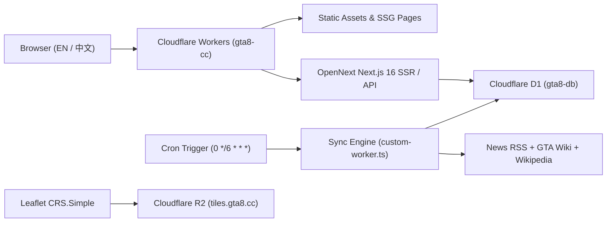

# GTA8.cc · GTA 6 Interactive Leonida Map & Complete Wiki

[](https://gta8.cc)
[](./LICENSE)
[](https://github.com/bluexp/gta8.cc/actions/workflows/ci.yml)
[](https://workers.cloudflare.com)

> **Live Site:** [https://gta8.cc](https://gta8.cc) | **GitHub:** [bluexp/gta8.cc](https://github.com/bluexp/gta8.cc) | **中文文档:** [README.zh-CN.md](./README.zh-CN.md)

**GTA8.cc** is a **100% open-source (MIT)**, dark-neon **Tool + Wiki** web application for *Grand Theft Auto VI* (Leonida), built with **Next.js 16 (App Router)**, **TypeScript**, **Tailwind CSS**, **Leaflet (`CRS.Simple`)**, **Fuse.js**, **Zustand**, and deployed globally on **Cloudflare Workers + D1 + Cron Triggers**.

Defaults to **English (`EN`)** with instant one-click switching to **Simplified Chinese (`中文`)** across every page, map tooltip, encyclopedia card, and admin screen.

---

## Key Features

- **Interactive Leonida Map (`/gta6/map`)**
  - Custom planar coordinate system (`Leaflet CRS.Simple`, `X/Y: [-2000, 2000]`) with zero Mercator distortion.
  - Switch between **Satellite** and **Vector Roads** layers (supports high-res `{z}/{x}/{y}.webp` tiles on Cloudflare R2 via `NEXT_PUBLIC_TILES_BASE_URL`).
  - Zoom-aware marker clustering, multi-category filtering (`Done / Total` counters), one-click **Mark Collected** dimming, right-click coordinate share links (`gta8.cc/gta6/map?x=1240&y=-850`), JSON backup export/import, and D1 cloud sync.
  - Built-in community submission & coordinate correction modal with Cloudflare Turnstile verification support.
- **Automated Continuous Intel Engine (`/gta6/intel`)**
  - Powered by a **Cloudflare Cron Trigger (`0 */6 * * *`)** running every 6 hours on the edge.
  - Automatically syncs 4 free public sources into Cloudflare D1 (`IntelFeed` & `SyncRun`): **GTA 6 English News RSS**, **GTA 6 Chinese News RSS**, **GTA Wiki (MediaWiki API)**, and **Wikipedia (`Grand_Theft_Auto_VI`)**.
- **100% Completion & Trophy Tracker (`/gta6/checklist`)**
  - Bidirectionally synced with map markers via Zustand + `localStorage` (zero-login persistence).
- **Vehicles & Weapons Encyclopedias (`/gta6/vehicles`, `/gta6/weapons`)**
  - Statically generated (SSG) detail pages with SVG 5-axis performance radar charts, Tier 1–5 anti-theft breakdown, attachments, and embedded **Mini Spawn Locator Maps** that fly directly to `/gta6/map`.
- **Collectibles Guide (`/gta6/collectibles`)**
  - WAiNK Scans, Stunt Jumps, Hidden Packages, and Neon Magazines with per-category progress bars.
- **PS5 / Xbox Cheat Codes (`/gta6/cheats`)**
  - Visual DualSense (`△ ○ × □ L1 R1 L2 R2`) and Xbox controller icons plus in-game phone dial numbers with instant copy.
- **Guides & Interactive Heist Payout Calculator (`/gta6/guides`)**
  - Real-time net player payout calculator after NPC crew cuts, fencing fees, gunfire damage loss, and setup costs.
- **Admin Ops & UGC Review Console (`/admin`)**
  - Protected by Cloudflare Worker secret `ADMIN_TOKEN`; trigger full multi-source syncs on demand and approve/reject community map pins directly into live D1.

---

## Architecture Overview



| Layer | Technology |
| --- | --- |
| Framework | Next.js 16 (App Router, Turbopack), React 19, TypeScript |
| Styling & Icons | Tailwind CSS v4, Lucide React |
| Map Engine | Leaflet (`CRS.Simple`) + Procedural SVG / R2 WebP Tile Pyramid |
| Client Search & State | Fuse.js (`public/search-index.json`), Zustand (`localStorage` + D1 Sync) |
| Edge Runtime & DB | Cloudflare Workers (`@opennextjs/cloudflare`), Cloudflare D1 (SQLite), Cron Triggers |
| Tile Pipeline | Python `pyvips` (`dzsave` Google WebP layout) + `rclone` to Cloudflare R2 |

---

## Project Structure

```text
.
├── custom-worker.ts              # Cloudflare Worker entry (OpenNext fetch + Cron scheduled)
├── wrangler.jsonc                # Cloudflare Workers, D1, Custom Domain & Cron config
├── open-next.config.ts           # @opennextjs/cloudflare adapter configuration
├── migrations/                   # Cloudflare D1 SQL migrations (0001_init, 0002_auto_sync)
├── prisma/schema.prisma          # Reference relational schema
├── scripts/
│   ├── generate-search-index.mjs # Build-time bilingual + pinyin Fuse.js index generator
│   └── slice-tiles.py            # pyvips high-res map -> {z}/{x}/{y}.webp tile slicer
├── src/
│   ├── app/                      # Next.js App Router pages, SEO sitemap/robots, API routes
│   ├── components/               # UI components (map, wiki, checklist, cheats, intel, admin)
│   ├── data/                     # Bilingual datasets & English copy map
│   ├── lib/                      # D1 client, auto-sync engine, i18n helpers, categories
│   ├── store/                    # Zustand progress & locale stores
│   └── types/                    # Domain & Cloudflare runtime TypeScript types
└── docs/                         # Architecture, API, and Deployment guides
```

---

## Quick Start (Local Development)

### Prerequisites
- Node.js `>= 20` (tested on Node 24)
- npm `>= 10`

### Install & Run

```bash
npm install
npm run search:index
npm run dev
```

Open [http://localhost:3000](http://localhost:3000).

### Local Cloudflare `workerd` + D1 Preview

```bash
# Apply local D1 migrations
npm run db:migrate:local

# Build OpenNext Cloudflare bundle and test inside local workerd
npm run cf:build
npx wrangler dev --local
```

### Verification Commands

```bash
npm run typecheck   # TypeScript strict check (tsc --noEmit)
npm run build       # Generate search index + Next.js production build
npm run cf:build    # Full Cloudflare Workers OpenNext bundle build
```

---

## Deployment to Cloudflare Workers

See the complete step-by-step runbook in **[docs/DEPLOYMENT.md](./docs/DEPLOYMENT.md)**.

Quick deploy summary:

```bash
npx wrangler login
npx wrangler d1 migrations apply gta8-db --remote
npx wrangler secret put ADMIN_TOKEN
npm run cf:deploy
```

---

## Documentation Index

- **[docs/ARCHITECTURE.md](./docs/ARCHITECTURE.md)** — System architecture, coordinate math, i18n strategy, D1 schema & Cron sync flow
- **[docs/API.md](./docs/API.md)** — Complete REST API reference for markers, progress, submissions, intel, and admin routes
- **[docs/DEPLOYMENT.md](./docs/DEPLOYMENT.md)** — Cloudflare Free Tier setup, D1 migrations, secrets, DNS, and R2 map tile slicing
- **[CONTRIBUTING.md](./CONTRIBUTING.md)** — How to contribute coordinates, wiki data, translations, or code
- **[SECURITY.md](./SECURITY.md)** — Vulnerability reporting & deployment hardening
- **[CODE_OF_CONDUCT.md](./CODE_OF_CONDUCT.md)** — Community standards
- **[wrangler.example.jsonc](./wrangler.example.jsonc)** — Clean Cloudflare template for self-hosting forks
- **[CHANGELOG.md](./CHANGELOG.md)** — Version history
- **[README.zh-CN.md](./README.zh-CN.md)** — 简体中文项目文档

---

## Disclaimer & License

**Unofficial Fan Project:** GTA8.cc is an independent, unofficial community tool and wiki not affiliated with, endorsed, or sponsored by Rockstar Games or Take-Two Interactive Software, Inc. All game titles, trademarks, vehicles, and locations belong to their respective owners.

Code is released under the [MIT License](./LICENSE).
